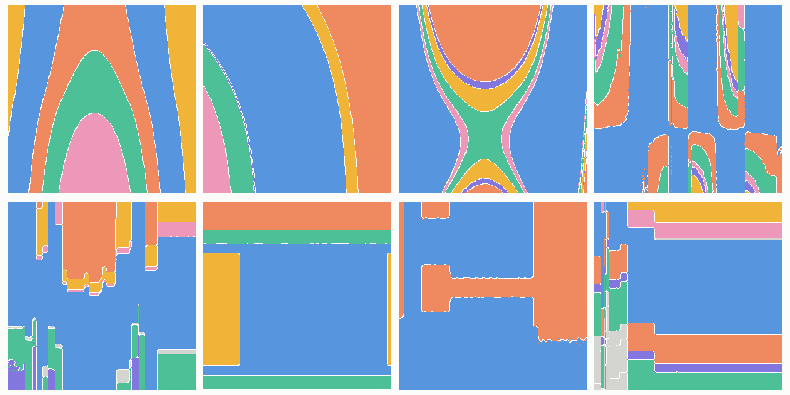

<div align="center">
  <h1>PluRel</h1>
  <p>
Synthetic Data unlocks Scaling Laws for Relational Foundation Models
</p>

[](https://star-project.stanford.edu/plurel)
[](https://arxiv.org/abs/2602.04029)
[](https://huggingface.co/stanford-star/rt-plurel)
[](https://huggingface.co/datasets/stanford-star/plurel)
[](https://pypi.org/project/plurel/)
[](LICENSE)


</div>
<br>

Models pretrained on PluRel data lead public relational benchmarks (at the time of submission):  
🥇 **RT-PluRel**, a [Relational Transformer](https://github.com/stanford-star/relational-transformer) pretrained on PluRel synthetic data, is #1 on the combined system + model leaderboard on [RelArena-α](https://star-project.stanford.edu/relarena-alpha) ([repro](https://github.com/stanford-star/relational-transformer/tree/main/examples/finetune)).  
🥇 **RT-J**, warm-started from RT-PluRel, is the #1 in-context model on the [RelBench leaderboard](https://star-project.stanford.edu/relbench/leaderboard) ([repro](https://github.com/stanford-star/relational-transformer/tree/main/examples/icl)).

## Latest Updates

- [10/2026] 🥇 **RT-PluRel** takes the top spot on [RelArena-α](https://star-project.stanford.edu/relarena-alpha). Checkpoints are on [Hugging Face](https://huggingface.co/stanford-star/rt-plurel).
- [07/2026] Released **v1.1.0** on [PyPI](https://pypi.org/project/plurel/) with the latest features and performance improvements.
- [04/2026] PluRel is accepted to **ICML 2026!**

## Overview

PluRel generates synthetic relational databases from structural causal models. Every table is a
small causal graph, foreign keys carry causal influence between tables, and a random prior draws
thousands of different databases in the [relbench](https://github.com/stanford-star/relbench)
format, which is what the [PluRel paper](https://arxiv.org/abs/2602.04029) pretrains on. You can
also write your own tables and databases, partly from real rows, and draw as many datasets of them
as you need.


> [!NOTE]
> Pretraining models on PluRel data (preprocessing, checkpoints, inference with
> [Relational Transformer](https://github.com/stanford-star/relational-transformer)) is covered in
> [`examples/relational_transformer/`](examples/relational_transformer/).

## Installation

PluRel needs Python 3.12 or newer. This README describes PluRel 2, which is not on PyPI yet; install
it from the `v2` branch, or pin a commit to reproduce a run (`pip install plurel` gives 1.1.0, the
[earlier API](https://github.com/stanford-star/plurel/tree/v1.1.0)):

```bash
pip install "git+https://github.com/stanford-star/plurel.git@v2"
```

## Quickstart

Random databases, as the paper generates them. A seed draws a database's structure and
mechanisms, and `rows` draws its table sizes:

<!-- standalone -->
```python
from plurel import SchemaPrior, create_database, split_timestamps, write_database

prior = SchemaPrior()
database = prior.realize(seed=0)                              # tables, keys and mechanisms
frames = database.sample(prior.rows(database, seed=0), seed=0)  # a dict of DataFrames
db = create_database(database, frames)                        # the relbench form
write_database(db, "~/.cache/relbench/quickstart", name="quickstart", overwrite=True,
               **dict(zip(("val_timestamp", "test_timestamp"), split_timestamps(db))))
```

A corpus, one process per database, lands in `~/.cache/relbench/plurel-<seed>`:

```bash
python scripts/synthetic_gen.py --seed_offset 0 --num_dbs 1000 --num_proc 16
```

A table you write yourself: each column says what it holds and what causes it.

<!-- standalone -->
```python
from plurel import Categorical, LogNormal, Numeric, PrimaryKey, Table, Uniform

customers = Table({
    "id": PrimaryKey(),
    "age": Numeric(Uniform(18, 80), round=1),
    "segment": Categorical({"bronze": 0.6, "silver": 0.3, "gold": 0.1}, causes={"age": 1.0}),
    "spend": Numeric(LogNormal(3, 0.5), causes={"age": 0.8, "segment": {"gold": 1.5}}),
})
print(customers.explain())
frame = customers.sample(500, seed=0)
```

A database of your own, saved for relbench:

<!-- standalone -->
```python
from plurel import ForeignKey, Numeric, PrimaryKey, Schema, Summary, Table, Uniform, create_database, write_database

schema = Schema({
    "teams": Table({"id": PrimaryKey(), "size": Numeric(causes={Summary("staff", "team_id"): 1.0}, noise=0)}),
    "staff": Table({"id": PrimaryKey(), "team_id": ForeignKey("teams"), "pay": Numeric(Uniform(40, 120))}),
})
frames = schema.sample({"teams": 5, "staff": 60}, seed=0)
write_database(create_database(schema, frames), "~/.cache/relbench/teams", name="teams", overwrite=True)
```

[`examples/`](examples/) has more: short [concept scripts](examples/concepts/) that each explain one
behaviour, and [domain recipes](examples/generation/) for retail orders, clinic visits and student
enrollments.

## Build a table

A `Table` is a dict of columns:

| Column | Holds |
|---|---|
| `PrimaryKey()` | Row positions, or the given `values` |
| `Numeric(marginal, causes, noise, missing, clip, round, zeros)` | Numbers following `marginal`, any distribution such as `Normal(50, 10)`, `Uniform(18, 80)`, `LogNormal(3, 0.5)` or `Poisson(4)` |
| `Categorical(levels, causes, noise, missing, ordered, scores)` | Levels, as a sequence of equally common levels or a dict of level to share |
| `Timestamp(start, end, causes, noise, missing)` | Times in the span; without one, the causes' sum in epoch seconds |
| `Hidden(causes, noise)` | A cause that other columns read but no column records |
| `Derived(function)` | A number computed from recorded numbers, named by the function's parameters |

`causes` maps a column to its effect:

| Cause and effect | Means |
|---|---|
| `"age": 0.8` | A weight: higher age means higher here; a negative weight means lower |
| `"age": (0.8, "tanh")` | A weight and a transform: `tanh`, `square`, `step`, `relu`, `abs`, `sin`, `exp`, `log` or any function |
| `"segment": {"gold": 1.5}` | An effect per level of a categorical cause |
| `("age", "tenure"): 0.8` | A weight on the product of two causes |
| `Recorded("price"): 2.0` | A weight on what `price` records, in its units |

A column is its causes' effects added up plus `noise` (0.5 by default). With a marginal, its rows
then take the marginal's values in that order, so the column holds its marginal exactly; a
`Numeric` without one records the sum itself. Either way a weight says how closely a column
follows its causes, not how many units it moves per unit. With one cause and the default noise,
weights of 0.25, 0.5, 1 and 2 give rank correlations of about 0.4, 0.7, 0.9 and 0.97. To compute in
units, read a cause `Recorded`, or use `Derived`;
[`02_latent_and_recorded.py`](examples/concepts/02_latent_and_recorded.py) shows both.
`sample_with_latents(rows, seed=..., held={"x": values})` also returns every node's latent values,
and with `held` sets a node's latents to the given ones: an intervention, seen in the columns that
read it.

`round=1` gives whole numbers and `round=0.01` cents, `clip=(lo, hi)` caps values, `zeros=0.2`
records a share of rows at 0, and `missing=0.1` blanks a share; columns reading a blanked column
still see its value. [`11_missing_and_unmatched.py`](examples/concepts/11_missing_and_unmatched.py)
covers blanks and fills.

## Link tables into a database

A `ForeignKey` points at another table, `"key.column"` reads a column of the row it points at, and
`time_column` names the column that orders a table's events:

```python
from plurel import Categorical, ForeignKey, LogNormal, Numeric, PrimaryKey, Schema, Table, Timestamp, Uniform

customers = Table({
    "id": PrimaryKey(),
    "segment": Categorical({"bronze": 0.6, "silver": 0.3, "gold": 0.1}),
    "spend": Numeric(LogNormal(3, 0.5), causes={"segment": {"gold": 1.5}}),
})
orders = Table(
    {
        "id": PrimaryKey(),
        "customer_id": ForeignKey("customers"),
        "time": Timestamp("2020-01-01", "2024-01-01"),
        "amount": Numeric(LogNormal(), causes={"customer_id.spend": 1.0}),
    },
    time_column="time",
)
schema = Schema({"customers": customers, "orders": orders})
frames = schema.sample({"customers": 500, "orders": 5000}, seed=0)
```

A key chooses its parent at random by default. Its options:

| Option | Says |
|---|---|
| `link` | How rows pick parents by structure: `RandomLink()`, `HSBMLink(popularity=Pareto(2.5))` for a few popular parents, `TreeLink(roots=0.05)` for a hierarchy within one table |
| `match={"region": "region"}` | Child and parent columns that must agree |
| `prefer={Recorded("beds"): 0.05}` | Weights on parents by their columns |
| `counts=Counts(4.0, causes=..., least=1, most=8)` | How many rows point at each parent, which sets the child table's size |
| `unique=True` or `unique="student_id"` | No parent repeated, across the table or per group |
| `unmatched="null"` | Rows no parent is left for point at nothing instead of raising |
| `nullable=0.02, fill=0.0` | A random share of rows point at nothing; `fill` is what reads across them see |

`Summary("staff", "team_id")` reads the rows pointing back: their count, or with a column and `sum`,
`mean`, `max` or `min` their aggregate; all but a count and a sum need a `fill` for rows nothing
points at, and a summary of a `Recorded` column skips blanks. A table counted by a key needs no row
count of its own:

```python
from plurel import Counts

school = Schema({
    "students": Table({"id": PrimaryKey(), "year": Numeric(Uniform(1, 4), round=1)}),
    "courses": Table({"id": PrimaryKey(), "level": Categorical(("intro", "advanced"))}),
    "enrollments": Table({
        "student_id": ForeignKey("students", counts=Counts(3.0, causes={"year": 0.5}, most=5)),
        "level": Categorical(("intro", "advanced"), causes={"student_id.year": 1.0}),
        "course_id": ForeignKey("courses", match={"level": "level"}, unique="student_id", unmatched="null", fill=0.0),
    }),
})
frames = school.sample({"students": 200, "courses": 30}, seed=0)
```

Which options combine, and how counts and summaries behave at the edges, is in
[`10_relational_schema.py`](examples/concepts/10_relational_schema.py) and
[`15_edge_cases.py`](examples/concepts/15_edge_cases.py); event order is in
[`12_temporal_data.py`](examples/concepts/12_temporal_data.py).

## Start from real rows

`Table.from_frame` keeps a real table's rows exactly; `extra` adds generated columns to them, and
generated tables point at its real keys and read its columns:

```python
import pandas as pd

real = pd.DataFrame({"customer_id": ["C1", "C2", "C3", "C4"], "age": [34, 51, 29, 62]})
people = Table.from_frame(
    real,
    primary_key="customer_id",
    extra={"churned": Categorical({"no": 0.8, "yes": 0.2}, causes={"age": -1.0})},
    target="churned",
)
purchases = Table({"id": PrimaryKey(), "customer_id": ForeignKey("people"), "amount": Numeric(LogNormal())})
frames = Schema({"people": people, "purchases": purchases}).sample({"purchases": 200}, seed=0)
assert frames["people"][["customer_id", "age"]].equals(real)
```

This augments the real rows; it does not learn to draw more rows like them. See
[`08_semi_synthetic_table.py`](examples/concepts/08_semi_synthetic_table.py) and
[`09_semi_synthetic_relations.py`](examples/concepts/09_semi_synthetic_relations.py).

## Author many tables from one description

Any weight, effect, noise or marginal may be a range. The table is then a family, and generating
takes two steps, each with its own seed:

- `realize(seed)`, the mechanism seed, draws one generator of the family: every range drawn, and
  categorical cuts and scores fit to a calibration draw.
- `sample(rows, seed=...)`, the data seed, draws a dataset of that generator; sampling never changes
  it.

```python
from plurel import MEDIUM, STRONG, Range, Scaled

family = Table({
    "wait_days": Numeric(Scaled("duration", 0, 60), round=1),
    "outcome": Categorical({"declined": 0.7, "accepted": 0.3}, causes={"wait_days": -STRONG}),
    "cost": Numeric(Scaled("amount", 0, 5000), causes={"wait_days": Range(0.2, 1.0)}, noise=MEDIUM),
})
generator = family.realize(seed=1)                  # one mechanism
first, second = generator.sample(1000, seed=10), generator.sample(1000, seed=11)
others = [family.realize(seed).sample(1000, seed=10) for seed in range(3)]  # three mechanisms
```

| Drawable | Draws |
|---|---|
| `Range(low, high)`; `WEAK`, `STRONG`; `LOW`, `MEDIUM`, `HIGH` | A number wherever a weight or noise goes; the named ones are strengths and noise levels |
| `Scaled(units, low, high, shape=None)` | A marginal on the range, shaped for `count`, `amount`, `duration`, `ratio`, `score`, `percent` or `signed` values |
| `Shares(levels)` | A categorical column's shares |
| `Noise(kind, std)` | Noise: `gaussian`, `laplace`, `student_t`, `skewed` or `gumbel` |
| `ByLevel(column, {level: (low, high)})` | A marginal with its own range per level of a categorical column |

`Schema.realize` does the same for a database. A table with neither ranges nor categorical
`scores` samples directly; one with `scores` is realized first, to fit them.
[`03_realization.py`](examples/concepts/03_realization.py) through
[`07_calibration_sizes.py`](examples/concepts/07_calibration_sizes.py) explain what realizing fits
and when it matters.

## Random tables and databases

`TablePrior` and `SchemaPrior` draw whole tables and databases. Every knob is a `Range` or a
`Choices`, listed in their docstrings. By default a database has 2 to 20 tables, 500 to 1,000 rows
per referenced table and 10,000 to 30,000 per event table:

```python
from plurel import IntegersRange, LogIntegersRange, SchemaPrior, TablePrior

table = TablePrior(column_count=IntegersRange(8, 8)).realize(seed=0, time=True)
frame = table.sample(1000, seed=0)

prior = SchemaPrior(table_count=IntegersRange(3, 5), entity_row_count=LogIntegersRange(1000, 2000))
database = prior.realize(seed=0)
frames = database.sample(prior.rows(database, seed=0), seed=0)
```

Each drawn table is its own causal mechanism. Holding two numeric nodes upstream of a categorical
column on a grid, with the table's other sources at typical values, shows the class each cell gets
most often; eight tables from `TablePrior`, drawn by
[`decision_boundaries.py`](examples/figures/decision_boundaries.py):



Every generated database keeps its keys valid under any time cut. How diverse the prior's databases
are, how hard their columns are to predict and how one compares with a real database are measured
in [`examples/analysis/`](examples/analysis/) and [`examples/reference/`](examples/reference/).

## Save and inspect

`create_database` orders event tables by time and turns keys into row positions, the relbench form;
`write_database` saves it and `read_database` loads it back. A database with events needs split
timestamps, from `split_timestamps(db)`; one without saves as is. `describe()` gives a table or
schema as plain JSON-ready data, every drawn weight and fitted cut included, and `explain()` as
readable lines:

```python
from plurel import create_database, read_database, split_timestamps, write_database

db = create_database(schema, schema.sample({"customers": 500, "orders": 5000}, seed=0))
val, test = split_timestamps(db)
path = write_database(db, "~/.cache/relbench/shop", name="shop", val_timestamp=val, test_timestamp=test, overwrite=True)
loaded = read_database(path)
print(schema.explain())
```

[`13_static_export.py`](examples/concepts/13_static_export.py) shows a database without events.

## Reproducibility

The same seeds and row counts give the same frames, byte for byte, on one platform and processor
type; across them the last bits of some numbers differ.
[COMPATIBILITY.md](COMPATIBILITY.md) says exactly what repeats, and [CHANGELOG.md](CHANGELOG.md)
lists changes that move draws. A draw is one dataset, not rows streamed from a population, so
`sample(200, seed=0).head(100)` is not `sample(100, seed=0)`; to build a larger dataset, draw parts
under their own seeds ([`04_sampling.py`](examples/concepts/04_sampling.py)).

## Latency and memory

A random database from the default prior, drawn, sampled, saved to parquet and read back, takes
about a third of a second and a few hundred megabytes, so a corpus of thousands fits on a laptop.
Measured on 100 tables and 100 databases with `plurel` at commit `287fef8`, on an Apple M4 and on
GitHub's `ubuntu-latest` runner:

| | Median | 90th percentile | Largest |
|---|---:|---:|---:|
| database: rows | 29,054 | 102,220 | 211,318 |
| database: seconds, M4 / Linux | 0.29 / 0.44 | 0.98 / 1.4 | 4.1 / 4.4 |
| database: peak memory, M4 / Linux | 264 / 290 MiB | 422 / 393 MiB | 776 / 702 MiB |
| table: seconds, M4 / Linux | 0.13 / 0.14 | 0.31 / 0.35 | 0.59 / 0.64 |

[benchmarks/](benchmarks/) has the harness and the full reports.

## Development

Set up the environment with [pixi](https://pixi.sh/latest/installation/):

```bash
pixi install
pixi run pre-commit install
pixi run test        # the suite
pixi run lint        # ruff check and format check
pixi run typecheck   # pyright over the public API
pixi run examples    # every README block, and each quickstart on its own
pixi run recipes     # every script in examples/, small, each in its own process
pixi run bench       # generation time and memory; see benchmarks/README.md
pixi run fingerprints  # rewrite test/fingerprints.json, for a change that moves draws on purpose
```

CI runs these on every pull request to `main` and `v2`, on Linux and macOS. The v1 generator, the
paper-exact code, remains at the [`v1.1.0`](https://github.com/stanford-star/plurel/tree/v1.1.0)
and [`v1.0.0`](https://github.com/stanford-star/plurel/tree/v1.0.0) tags.

## Citation

If you find this work useful, please cite our paper:

```bibtex
@inproceedings{kothapalli2026plurel,
    title={{PluRel:} Synthetic Data unlocks Scaling Laws for Relational Foundation Models},
    author={Vignesh Kothapalli and Rishabh Ranjan and Valter Hudovernik and Vijay Prakash Dwivedi and Johannes Hoffart and Carlos Guestrin and Jure Leskovec},
    booktitle={Forty-third International Conference on Machine Learning},
    year={2026}
}
```
