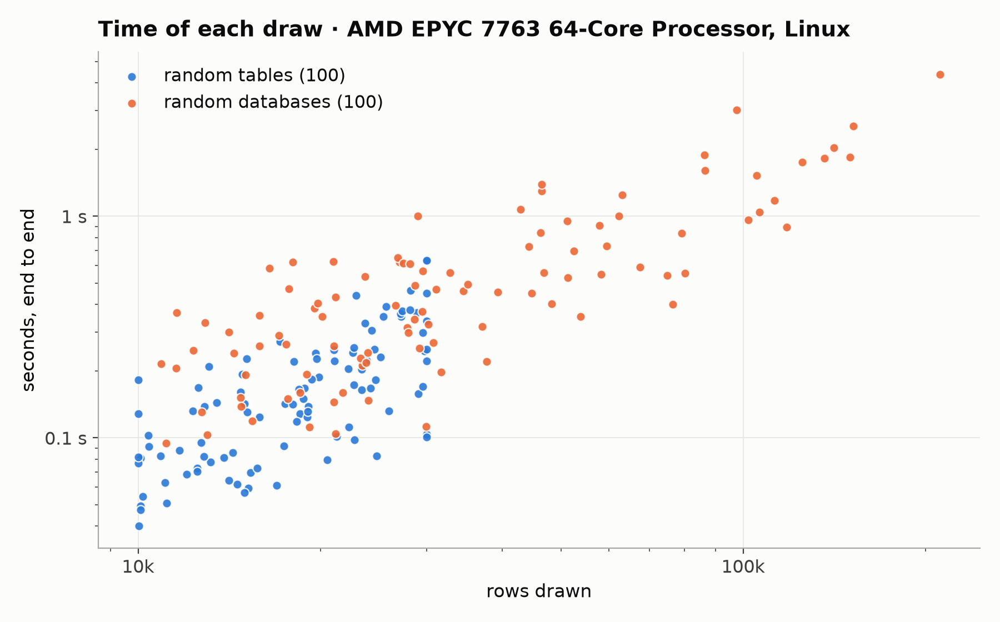
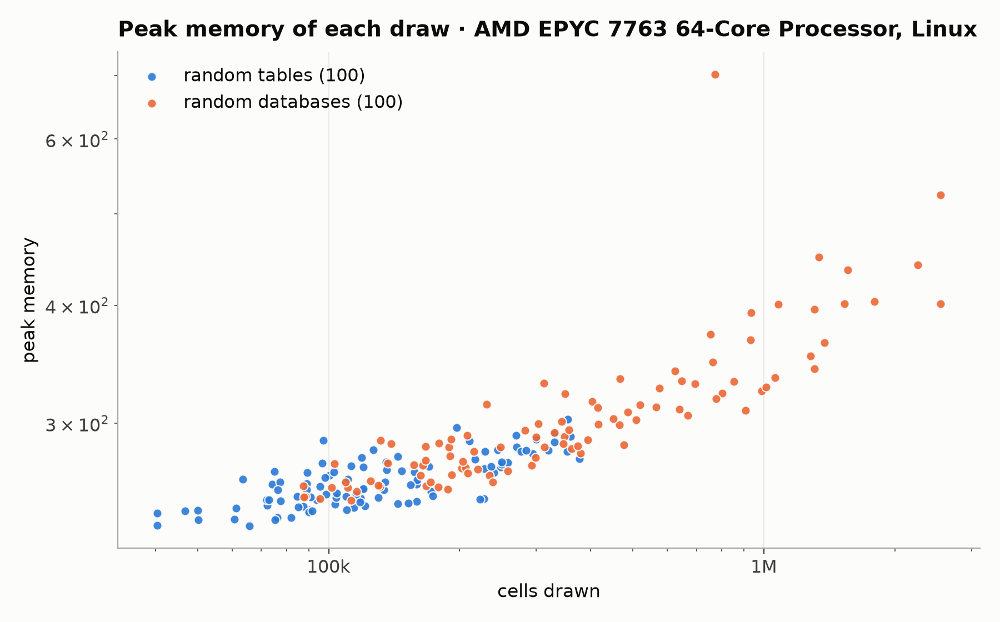

# Generation benchmark

Generated by `benchmarks/report.py` from [`results/2026-11-09-github-ubuntu.json`](results/2026-11-09-github-ubuntu.json); rerun with the command in [benchmarks/README.md](README.md). Each draw is one table or database from the default prior, at the row counts the prior draws, in a fresh process with no warm-up; peak memory includes the interpreter and imports, about 195 MiB.

## Environment

| | |
|---|---|
| plurel | `287fef8`, the last commit to change it |
| harness | `7223775` |
| when | 2026-11-09T02:40:21+00:00 |
| machine | AMD EPYC 7763 64-Core Processor, 4 cores, 15.6 GiB, x86_64 |
| platform | Linux-7.0.0-1019-azure-x86_64-with-glibc2.43 |
| Python | 3.12.0 |
| packages | plurel 2.0.0.dev0, numpy 2.5.1, pandas 3.0.5, pyarrow 25.0.0, scipy 1.17.0, relbench 3.0.1 |
| threads | library defaults |

## Random tables: 100 draws, 0 failed

| | median | 90th percentile | largest | smallest |
|---|---:|---:|---:|---:|
| tables | 1 | 1 | 1 | 1 |
| keys | 0 | 0 | 0 | 0 |
| rows | 18,783 | 29,520 | 30,000 | 10,000 |
| cells | 118,772 | 277,658 | 377,195 | 40,344 |
| seconds, end to end | 0.14 | 0.35 | 0.64 | 0.04 |
| seconds sampling | 0.09 | 0.30 | 0.58 | 0.01 |
| rows per second, end to end | 122,464 | 221,270 | 299,324 | 47,185 |
| peak memory, MiB | 258 | 281 | 303 | 234 |
| on disk, MiB | 0.6 | 1.4 | 2.1 | 0.1 |

Median share of the time: draw 2%, sample 66%, database 0%, write 15%, read 17%.

Slowest draws:

| seed | tables | keys | rows | seconds | peak MiB |
|---:|---:|---:|---:|---:|---:|
| 46 | 1 | 0 | 30,000 | 0.64 | 288 |
| 82 | 1 | 0 | 29,949 | 0.63 | 291 |
| 74 | 1 | 0 | 28,174 | 0.46 | 270 |
| 17 | 1 | 0 | 29,997 | 0.45 | 292 |
| 57 | 1 | 0 | 22,896 | 0.44 | 280 |

## Random databases: 100 draws, 0 failed

| | median | 90th percentile | largest | smallest |
|---|---:|---:|---:|---:|
| tables | 5 | 20 | 20 | 2 |
| keys | 6 | 39 | 105 | 1 |
| rows | 29,054 | 102,220 | 211,318 | 10,923 |
| cells | 336,644 | 1,282,567 | 2,549,317 | 87,574 |
| seconds, end to end | 0.44 | 1.41 | 4.37 | 0.09 |
| seconds sampling | 0.29 | 1.22 | 4.01 | 0.05 |
| rows per second, end to end | 75,096 | 139,033 | 265,235 | 28,228 |
| peak memory, MiB | 290 | 393 | 702 | 248 |
| on disk, MiB | 1.7 | 5.9 | 11.4 | 0.3 |

Median share of the time: draw 6%, sample 73%, database 0%, write 11%, read 8%.

Slowest draws:

| seed | tables | keys | rows | seconds | peak MiB |
|---:|---:|---:|---:|---:|---:|
| 56 | 20 | 67 | 211,318 | 4.37 | 523 |
| 91 | 20 | 39 | 97,448 | 3.01 | 436 |
| 97 | 20 | 89 | 151,920 | 2.56 | 401 |
| 33 | 20 | 30 | 141,081 | 2.04 | 393 |
| 64 | 10 | 19 | 86,262 | 1.89 | 396 |

## Failures

None: all 200 draws finished.

## Figures

