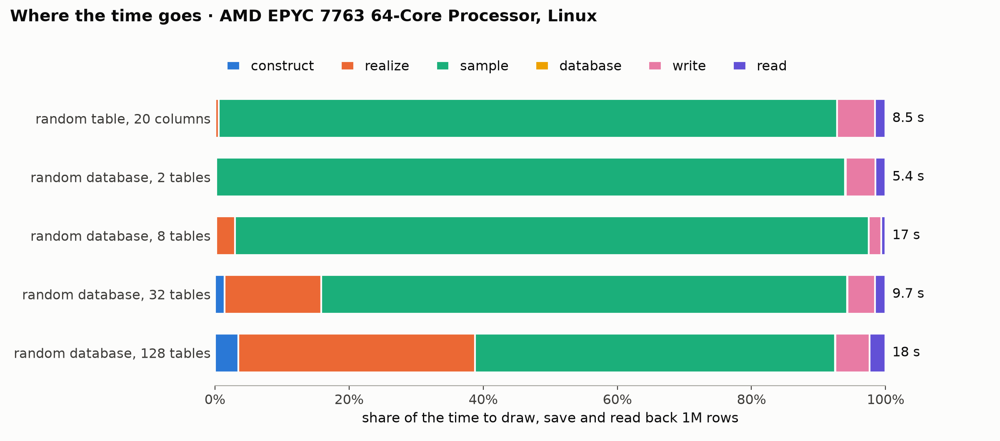

# Generation benchmark

Generated by `benchmarks/report.py` from [`results/2026-11-09-github-ubuntu.json`](results/2026-11-09-github-ubuntu.json); rerun with the command in [benchmarks/README.md](README.md), which describes the workloads. Times are seconds, the median of the runs with their range in brackets; each run is a fresh process with no warm-up, so peak memory includes the interpreter and imports (about 195 MiB).

## Environment

| | |
|---|---|
| commit | `1c546a1` |
| when | 2026-11-09T00:43:30+00:00 |
| machine | AMD EPYC 7763 64-Core Processor, 4 cores, 15.6 GiB, x86_64 |
| platform | Linux-7.0.0-1019-azure-x86_64-with-glibc2.43 |
| Python | 3.12.0 |
| packages | plurel 2.0.0.dev0, numpy 2.5.1, pandas 3.0.5, pyarrow 25.0.0, scipy 1.17.0, relbench 3.0.1 |
| threads | library defaults |

## Phases

| Workload | Tables | Rows | Cells | construct | realize | sample | database | write | read | Total | Rows/s sampled | Peak MiB | Disk MiB |
|---|---:|---:|---:|---:|---:|---:|---:|---:|---:|---:|---:|---:|---:|
| random table, 20 columns | 1 | 100,000 | 2,100,000 | 0.0046 | 0.0484 (0.0451–0.0561) | 0.813 (0.79–0.83) | 0.0002 | 0.0895 (0.0889–0.0968) | 0.0284 (0.0275–0.0372) | 0.982 (0.957–1.03) | 0.12M | 434 (430–438) | 12.2 |
| random table, 20 columns | 1 | 250,000 | 5,250,000 | 0.0046 | 0.0476 | 1.97 (1.96–2) | 0.0002 | 0.226 (0.218–0.235) | 0.0457 | 2.3 (2.29–2.31) | 0.13M | 644 (644–646) | 28.0 |
| random table, 20 columns | 1 | 500,000 | 10,500,000 | 0.0046 | 0.0444 | 3.93 (3.9–4.1) | 0.0002 | 0.31 | 0.0806 | 4.37 (4.34–4.54) | 0.13M | 705 (705–705) | 52.4 |
| random table, 20 columns | 1 | 1,000,000 | 21,000,000 | 0.0047 | 0.0463 | 7.8 (7.77–7.84) | 0.0002 | 0.481 (0.476–0.483) | 0.132 (0.13–0.135) | 8.45 (8.44–8.51) | 0.13M | 1,228 (1,223–1,236) | 101.1 |
| random database, 2 tables | 2 | 100,000 | 1,088,456 | 0.0109 | 0.0004 | 0.582 (0.579–0.621) | 0.001 | 0.0526 | 0.0248 | 0.672 (0.67–0.709) | 0.17M | 344 (344–345) | 5.7 |
| random database, 2 tables | 2 | 250,000 | 2,721,138 | 0.0114 | 0.0004 | 1.36 (1.35–1.39) | 0.0017 | 0.108 | 0.0338 | 1.52 (1.5–1.54) | 0.18M | 464 (462–468) | 13.1 |
| random database, 2 tables | 2 | 500,000 | 5,442,276 | 0.0112 | 0.0004 | 2.62 (2.58–2.64) | 0.0029 | 0.156 (0.146–0.16) | 0.0527 | 2.83 (2.8–2.87) | 0.19M | 572 (571–576) | 24.7 |
| random database, 2 tables | 2 | 1,000,000 | 10,884,552 | 0.0114 | 0.0004 | 5.05 (5.01–5.07) | 0.0053 | 0.238 | 0.0826 | 5.39 (5.35–5.4) | 0.20M | 885 (879–911) | 48.0 |
| random database, 8 tables | 8 | 100,000 | 1,356,606 | 0.0369 | 0.474 (0.464–0.524) | 1.71 (1.71–1.71) | 0.0016 | 0.0994 | 0.0436 | 2.37 (2.35–2.42) | 0.06M | 397 (397–397) | 8.5 |
| random database, 8 tables | 8 | 250,000 | 3,391,518 | 0.0379 | 0.466 (0.462–0.489) | 4.24 (4.19–4.26) | 0.0019 | 0.172 | 0.0534 | 4.97 (4.93–5.01) | 0.06M | 645 (644–645) | 20.0 |
| random database, 8 tables | 8 | 500,000 | 6,783,034 | 0.0369 | 0.464 | 8.24 (8.2–8.37) | 0.0029 | 0.225 (0.219–0.229) | 0.071 | 9.04 (9–9.17) | 0.06M | 1,134 (1,076–1,138) | 37.5 |
| random database, 8 tables | 8 | 1,000,000 | 13,566,076 | 0.0373 | 0.475 (0.462–0.514) | 16.1 (16.1–16.1) | 0.0046 | 0.315 (0.313–0.328) | 0.113 | 17 (17–17.1) | 0.06M | 1,874 (1,874–1,874) | 72.9 |
| random database, 32 tables | 32 | 100,000 | 925,407 | 0.143 | 1.42 (1.39–1.43) | 0.944 (0.94–0.952) | 0.0022 | 0.145 | 0.108 | 2.77 (2.73–2.77) | 0.11M | 373 (372–383) | 4.3 |
| random database, 32 tables | 32 | 250,000 | 2,313,553 | 0.139 | 1.4 (1.38–1.43) | 2.03 (2–2.05) | 0.0027 | 0.195 | 0.112 | 3.88 (3.86–3.9) | 0.12M | 423 (422–427) | 10.8 |
| random database, 32 tables | 32 | 500,000 | 4,627,092 | 0.138 | 1.4 (1.38–1.4) | 3.85 (3.83–4.03) | 0.0033 | 0.28 (0.275–0.313) | 0.125 (0.124–0.137) | 5.79 (5.76–6.02) | 0.13M | 601 (600–602) | 20.8 |
| random database, 32 tables | 32 | 1,000,000 | 9,254,176 | 0.139 | 1.39 (1.38–1.43) | 7.58 (7.57–7.72) | 0.0047 | 0.399 (0.396–0.405) | 0.153 | 9.67 (9.66–9.85) | 0.13M | 841 (835–844) | 40.9 |
| random database, 128 tables | 128 | 100,000 | 1,020,378 | 0.639 (0.631–0.643) | 6.38 (6.38–6.49) | 1.94 (1.94–1.97) | 0.006 | 0.384 | 0.38 | 9.74 (9.73–9.87) | 0.05M | 558 (554–558) | 6.1 |
| random database, 128 tables | 128 | 250,000 | 2,550,946 | 0.632 (0.626–0.639) | 6.41 (6.39–6.46) | 3.28 (3.26–3.28) | 0.0074 | 0.58 (0.572–0.584) | 0.389 (0.383–0.393) | 11.3 (11.2–11.4) | 0.08M | 641 (639–643) | 14.4 |
| random database, 128 tables | 128 | 500,000 | 5,101,890 | 0.62 | 6.26 (6.23–6.39) | 5.29 (5.26–5.32) | 0.0071 | 0.69 (0.681–0.694) | 0.401 (0.394–0.403) | 13.3 (13.2–13.4) | 0.09M | 687 (686–690) | 28.4 |
| random database, 128 tables | 128 | 1,000,000 | 10,203,772 | 0.63 (0.622–0.632) | 6.37 (6.24–6.78) | 9.7 (9.62–9.81) | 0.0073 | 0.922 (0.917–0.935) | 0.427 (0.424–0.43) | 18.1 (17.9–18.6) | 0.10M | 930 (916–931) | 56.3 |

## Failures

None: all 60 runs finished.

## Figures

