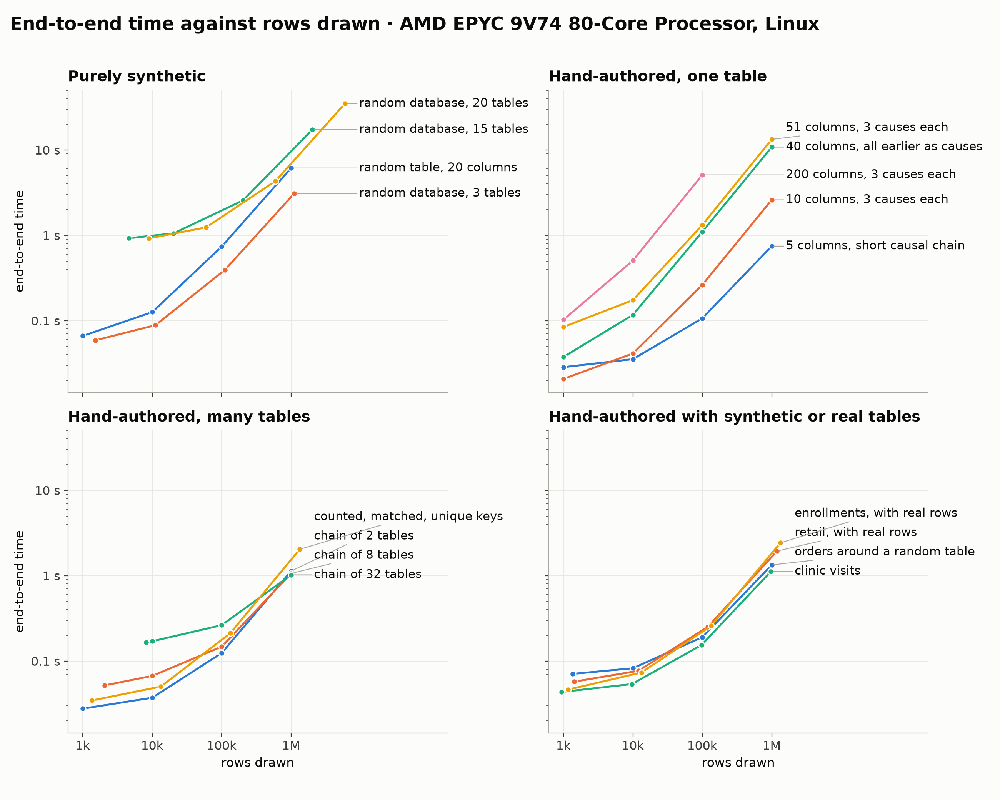
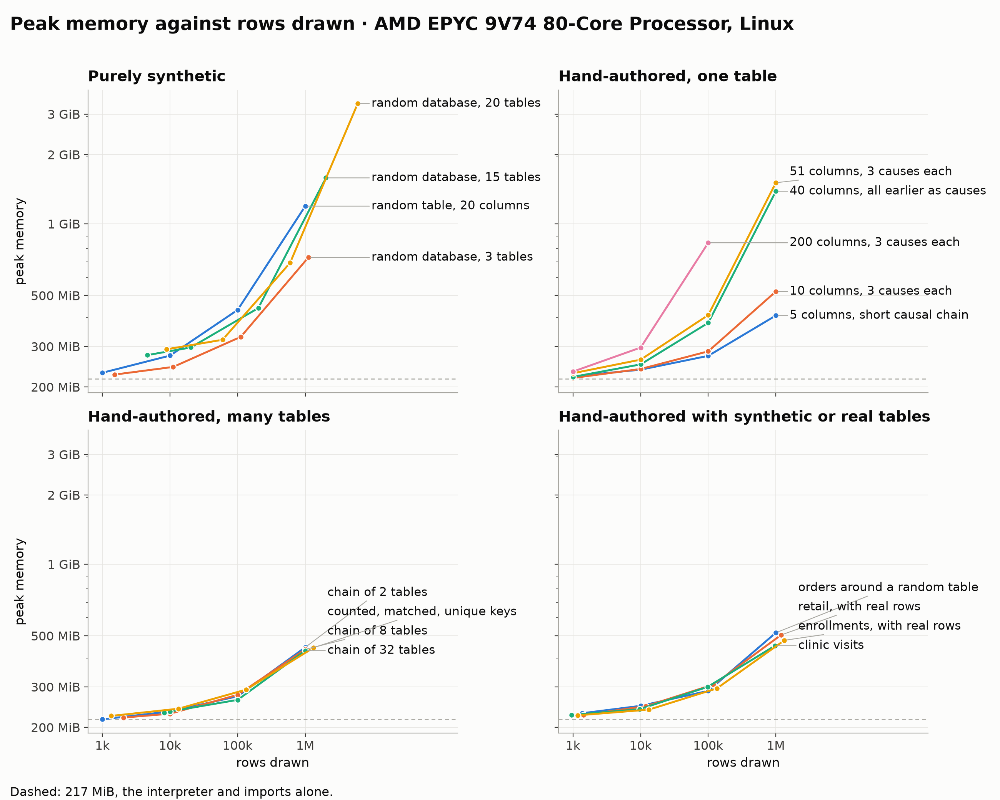
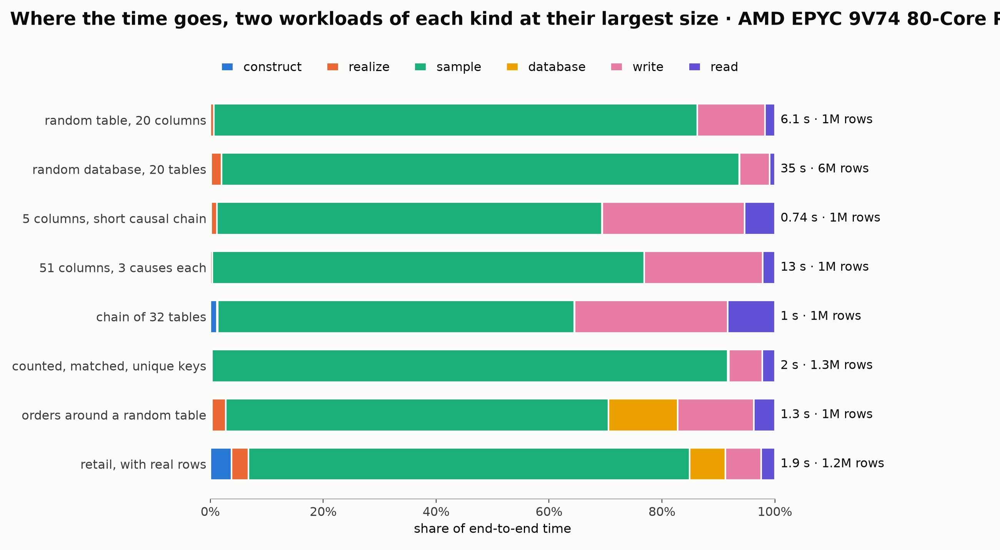

# Generation benchmark

Generated by `benchmarks/report.py` from [`results/2026-11-08-github-ubuntu-7241cbc.json`](results/2026-11-08-github-ubuntu-7241cbc.json); rerun with the command in [benchmarks/README.md](README.md). Times are seconds, the median over every seed and repeat with the range in brackets; each run is a fresh process with no warm-up, so peak memory includes the interpreter and imports (about 190 MiB). The workloads are described in [benchmarks/README.md](README.md#workloads).

## Environment

| | |
|---|---|
| commit | `7241cbc` |
| when | 2026-11-08T23:31:41+00:00 |
| machine | AMD EPYC 9V74 80-Core Processor, 4 cores, 15.6 GiB, x86_64 |
| platform | Linux-7.0.0-1019-azure-x86_64-with-glibc2.43 |
| Python | 3.12.0 |
| packages | plurel 2.0.0.dev0, numpy 2.5.1, pandas 3.0.5, pyarrow 25.0.0, scipy 1.17.0, relbench 3.0.1 |
| threads | library defaults |

## Phases

| Workload | Size | Rows (generated) | Cells (generated) | construct | realize | sample | database | write | read | Total | Generated rows/s sampled | Generated cells/s sampled | Peak MiB | Disk MiB |
|---|---:|---:|---:|---:|---:|---:|---:|---:|---:|---:|---:|---:|---:|---:|
| columns-10 | 1,000 | 1,000 (1,000) | 10,000 (10,000) | 0.0013 | 0.0001 | 0.0047 | 0.0001 | 0.00445 | 0.01 | 0.0208 | 0.21M | 2.13M | 219 (219–221) | 0.1 |
| columns-10 | 10,000 | 10,000 (10,000) | 100,000 (100,000) | 0.0013 | 0.0001 | 0.0171 | 0.0001 | 0.0112 | 0.0118 | 0.0413 (0.0403–0.0463) | 0.58M | 5.83M | 239 (236–244) | 0.9 |
| columns-10 | 100,000 | 100,000 (100,000) | 1,000,000 (1,000,000) | 0.0013 | 0.0001 | 0.171 | 0.0001 | 0.0717 (0.0479–0.109) | 0.019 | 0.263 (0.238–0.299) | 0.59M | 5.86M | 286 (280–291) | 9.6 |
| columns-10 | 1,000,000 | 1,000,000 (1,000,000) | 10,000,000 (10,000,000) | 0.0013 | 0.0001 | 2.04 (2.03–2.05) | 0.0002 | 0.489 (0.423–0.67) | 0.0674 | 2.6 (2.54–2.76) | 0.49M | 4.90M | 520 (516–522) | 78.9 |
| columns-200 | 1,000 | 1,000 (1,000) | 200,000 (200,000) | 0.0155 | 0.0013 | 0.0428 | 0.00025 | 0.0241 (0.0215–0.0275) | 0.0186 | 0.103 (0.0983–0.109) | 0.02M | 4.67M | 233 (233–243) | 1.9 |
| columns-200 | 10,000 | 10,000 (10,000) | 2,000,000 (2,000,000) | 0.0157 | 0.0013 | 0.287 | 0.00025 | 0.172 (0.11–0.201) | 0.0307 | 0.506 (0.447–0.539) | 0.03M | 6.96M | 297 (296–301) | 18.7 |
| columns-200 | 100,000 | 100,000 (100,000) | 20,000,000 (20,000,000) | 0.0156 | 0.0013 | 3.3 (3.29–3.33) | 0.00035 | 1.63 (1.57–1.81) | 0.149 (0.145–0.151) | 5.09 (5.06–5.27) | 0.03M | 6.06M | 847 (844–849) | 191.4 |
| dense | 1,000 | 1,000 (1,000) | 40,000 (40,000) | 0.00635 | 0.0005 | 0.012 | 0.0001 | 0.00785 | 0.0109 | 0.0376 | 0.08M | 3.35M | 221 (220–222) | 0.4 |
| dense | 10,000 | 10,000 (10,000) | 400,000 (400,000) | 0.00635 | 0.0005 | 0.0667 | 0.00015 | 0.0278 (0.0274–0.0337) | 0.0153 | 0.117 (0.116–0.123) | 0.15M | 6.00M | 251 (249–258) | 3.7 |
| dense | 100,000 | 100,000 (100,000) | 4,000,000 (4,000,000) | 0.00645 | 0.0005 | 0.748 (0.733–0.763) | 0.0002 | 0.3 (0.281–0.398) | 0.0402 | 1.1 (1.08–1.18) | 0.13M | 5.35M | 380 (380–386) | 38.3 |
| dense | 1,000,000 | 1,000,000 (1,000,000) | 40,000,000 (40,000,000) | 0.00655 | 0.0005 | 8.75 (8.65–8.8) | 0.0003 | 1.8 (1.71–2.06) | 0.231 (0.225–0.234) | 10.8 (10.7–11.1) | 0.11M | 4.57M | 1,419 (1,419–1,419) | 315.7 |
| enrollments | 1,000 | 1,172 (842) | 5,200 (4,210) | 0.0074 | 0.01 | 0.0058 | 0.00145 | 0.0075 | 0.0142 | 0.0464 (0.0434–0.0563) | 0.14M | 0.71M | 226 (223–226) | 0.0 |
| enrollments | 10,000 | 13,267 (9,787) | 59,375 (48,935) | 0.0089 | 0.0211 | 0.0158 | 0.0032 | 0.00965 | 0.0141 | 0.0733 (0.0693–0.0798) | 0.62M | 3.09M | 239 (237–244) | 0.1 |
| enrollments | 100,000 | 134,080 (99,100) | 600,440 (495,500) | 0.0215 | 0.0255 | 0.158 (0.153–0.164) | 0.0204 | 0.0183 | 0.0149 | 0.258 (0.253–0.269) | 0.63M | 3.13M | 295 (290–296) | 0.8 |
| enrollments | 1,000,000 | 1,337,309 (988,379) | 5,988,685 (4,941,895) | 0.178 (0.169–0.187) | 0.0234 | 1.7 (1.69–1.73) | 0.359 (0.334–0.401) | 0.126 (0.1–0.131) | 0.0452 | 2.43 (2.4–2.48) | 0.58M | 2.90M | 478 (474–505) | 8.5 |
| keyed | 1,000 | 1,346 (1,306) | 4,678 (4,598) | 0.00495 | 0.0002 | 0.0082 | 0.0008 | 0.00695 | 0.0129 | 0.0345 | 0.16M | 0.56M | 224 (223–226) | 0.0 |
| keyed | 10,000 | 13,291 (13,251) | 46,458 (46,378) | 0.0049 | 0.0002 | 0.0207 (0.0198–0.0251) | 0.0008 | 0.00935 | 0.0137 | 0.0503 (0.0479–0.0559) | 0.64M | 2.24M | 241 (239–244) | 0.1 |
| keyed | 100,000 | 132,929 (132,889) | 465,010 (464,930) | 0.0052 | 0.0002 | 0.171 (0.166–0.176) | 0.0012 | 0.0188 | 0.0153 | 0.212 (0.207–0.216) | 0.78M | 2.73M | 292 (290–293) | 1.6 |
| keyed | 1,000,000 | 1,329,187 (1,329,147) | 4,650,042 (4,649,962) | 0.00555 | 0.0002 | 1.85 (1.82–1.94) | 0.0052 | 0.119 (0.0836–0.181) | 0.0452 | 2.04 (2.01–2.11) | 0.72M | 2.52M | 444 (439–450) | 15.2 |
| mixed | 1,000 | 1,362 (1,362) | 7,834 (7,834) | 0.0036 | 0.0333 (0.032–0.0377) | 0.0086 | 0.0008 | 0.0084 | 0.0152 | 0.0707 (0.0683–0.0757) | 0.16M | 0.91M | 230 (229–232) | 0.1 |
| mixed | 10,000 | 10,000 (10,000) | 51,000 (51,000) | 0.0037 | 0.0333 | 0.0147 | 0.0016 | 0.0117 | 0.016 | 0.0824 (0.0784–0.0856) | 0.68M | 3.46M | 248 (245–249) | 0.3 |
| mixed | 100,000 | 100,000 (100,000) | 510,000 (510,000) | 0.00365 | 0.0357 | 0.0943 (0.0911–0.0976) | 0.0126 | 0.0249 (0.0247–0.0314) | 0.0178 | 0.19 (0.187–0.193) | 1.06M | 5.41M | 288 (284–291) | 3.0 |
| mixed | 1,000,000 | 1,000,000 (1,000,000) | 5,100,000 (5,100,000) | 0.0036 | 0.0334 (0.0321–0.039) | 0.903 (0.898–0.907) | 0.163 (0.161–0.166) | 0.18 (0.16–0.219) | 0.0494 | 1.34 (1.31–1.37) | 1.11M | 5.65M | 516 (503–527) | 26.2 |
| narrow | 1,000 | 1,000 (1,000) | 5,000 (5,000) | 0.0012 | 0.0077 | 0.0021 | 0.0001 | 0.00615 (0.0051–0.016) | 0.0105 (0.0098–0.0165) | 0.0285 (0.0268–0.037) | 0.48M | 2.38M | 222 (222–228) | 0.0 |
| narrow | 10,000 | 10,000 (10,000) | 50,000 (50,000) | 0.0012 | 0.00745 | 0.0061 | 0.0001 | 0.00945 | 0.0117 | 0.0355 | 1.64M | 8.21M | 238 (238–238) | 0.4 |
| narrow | 100,000 | 100,000 (100,000) | 500,000 (500,000) | 0.0012 | 0.00725 | 0.0544 (0.05–0.0568) | 0.0001 | 0.0265 (0.0255–0.0322) | 0.0145 | 0.107 (0.0985–0.11) | 1.84M | 9.20M | 273 (270–276) | 3.8 |
| narrow | 1,000,000 | 1,000,000 (1,000,000) | 5,000,000 (5,000,000) | 0.0012 | 0.00755 | 0.507 (0.502–0.542) | 0.00015 | 0.188 (0.172–0.376) | 0.0397 | 0.747 (0.728–0.931) | 1.97M | 9.86M | 409 (408–409) | 31.2 |
| prior-0 | 1,000 | 4,584 (4,584) | 51,144 (51,144) | 0.0513 | 0.683 (0.676–0.72) | 0.119 | 0.0008 | 0.029 | 0.0393 | 0.923 (0.914–0.963) | 0.04M | 0.43M | 275 (275–279) | 0.4 |
| prior-0 | 10,000 | 20,216 (20,216) | 242,094 (242,094) | 0.0513 | 0.686 (0.672–0.741) | 0.231 (0.227–0.235) | 0.0008 | 0.04 | 0.0404 | 1.05 (1.03–1.1) | 0.09M | 1.05M | 297 (295–297) | 1.6 |
| prior-0 | 100,000 | 202,158 (202,158) | 2,420,932 (2,420,932) | 0.0519 | 0.688 (0.672–0.723) | 1.6 (1.59–1.61) | 0.0016 | 0.163 (0.156–0.166) | 0.0538 (0.0535–0.0604) | 2.56 (2.53–2.59) | 0.13M | 1.51M | 441 (431–445) | 15.9 |
| prior-0 | 1,000,000 | 2,021,604 (2,021,604) | 24,209,624 (24,209,624) | 0.0514 | 0.681 (0.68–0.712) | 15.4 (15.3–15.6) | 0.00485 | 0.955 (0.942–0.999) | 0.163 (0.16–0.17) | 17.3 (17.1–17.4) | 0.13M | 1.57M | 1,623 (1,609–1,631) | 143.1 |
| prior-1 | 1,000 | 1,512 (1,512) | 12,632 (12,632) | 0.0076 | 0.0003 | 0.0209 | 0.00045 | 0.0105 | 0.0184 | 0.0588 (0.0561–0.0611) | 0.07M | 0.60M | 226 (225–230) | 0.1 |
| prior-1 | 10,000 | 11,110 (11,110) | 82,162 (82,162) | 0.0077 | 0.0003 | 0.0455 | 0.0005 | 0.0142 | 0.0193 (0.018–0.0231) | 0.0886 (0.0837–0.0918) | 0.24M | 1.81M | 244 (241–252) | 0.3 |
| prior-1 | 100,000 | 111,101 (111,101) | 821,630 (821,630) | 0.0075 | 0.0003 | 0.326 (0.315–0.353) | 0.0008 | 0.0363 (0.0356–0.0413) | 0.0224 | 0.394 (0.382–0.42) | 0.34M | 2.52M | 330 (327–334) | 3.5 |
| prior-1 | 1,000,000 | 1,111,009 (1,111,009) | 8,216,286 (8,216,286) | 0.00735 | 0.0003 | 2.74 (2.73–2.75) | 0.0044 | 0.272 (0.265–0.344) | 0.0683 | 3.09 (3.07–3.17) | 0.41M | 3.00M | 731 (724–736) | 30.7 |
| prior-2 | 1,000 | 8,878 (8,878) | 100,437 (100,437) | 0.0548 | 0.626 (0.62–0.656) | 0.14 | 0.0019 | 0.0427 | 0.0536 | 0.92 (0.912–0.949) | 0.06M | 0.72M | 292 (290–292) | 0.6 |
| prior-2 | 10,000 | 59,723 (59,723) | 654,752 (654,752) | 0.0548 | 0.634 (0.623–0.654) | 0.421 (0.42–0.428) | 0.0022 | 0.0658 | 0.0568 | 1.24 (1.22–1.25) | 0.14M | 1.55M | 321 (319–333) | 3.0 |
| prior-2 | 100,000 | 596,605 (596,605) | 6,541,409 (6,541,409) | 0.0546 | 0.634 (0.632–0.644) | 3.28 (3.26–3.3) | 0.0046 | 0.266 (0.242–0.293) | 0.0832 | 4.33 (4.3–4.36) | 0.18M | 1.99M | 693 (685–697) | 30.1 |
| prior-2 | 1,000,000 | 5,966,031 (5,966,031) | 65,413,893 (65,413,893) | 0.0553 | 0.633 (0.624–0.635) | 32 (31.8–32.3) | 0.0248 (0.0246–0.0315) | 1.85 (1.66–1.92) | 0.333 (0.327–0.339) | 34.9 (34.6–35.2) | 0.19M | 2.04M | 3,414 (3,413–3,414) | 260.4 |
| prior-table | 1,000 | 1,000 (1,000) | 21,000 (21,000) | 0.00315 | 0.0332 (0.0314–0.0378) | 0.0108 | 0.0001 | 0.0061 | 0.012 | 0.0663 (0.0633–0.0702) | 0.09M | 1.94M | 231 (230–232) | 0.1 |
| prior-table | 10,000 | 10,000 (10,000) | 210,000 (210,000) | 0.0032 | 0.034 | 0.0577 (0.0542–0.0614) | 0.0001 | 0.0183 (0.0156–0.0209) | 0.0129 | 0.126 (0.122–0.133) | 0.17M | 3.64M | 274 (272–281) | 1.2 |
| prior-table | 100,000 | 100,000 (100,000) | 2,100,000 (2,100,000) | 0.00315 | 0.0339 (0.0316–0.0389) | 0.559 (0.55–0.569) | 0.0001 | 0.118 (0.109–0.13) | 0.0224 | 0.739 (0.718–0.764) | 0.18M | 3.76M | 433 (431–437) | 12.2 |
| prior-table | 1,000,000 | 1,000,000 (1,000,000) | 21,000,000 (21,000,000) | 0.00315 | 0.0341 (0.0318–0.0373) | 5.25 (5.22–5.27) | 0.0002 | 0.731 (0.66–0.884) | 0.108 (0.107–0.115) | 6.13 (6.06–6.3) | 0.19M | 4.00M | 1,223 (1,209–1,227) | 101.2 |
| retail | 1,000 | 1,425 (1,281) | 6,813 (6,405) | 0.0093 | 0.0129 | 0.00795 | 0.0014 | 0.00955 | 0.0163 | 0.0573 (0.054–0.0612) | 0.15M | 0.76M | 226 (224–227) | 0.0 |
| retail | 10,000 | 11,959 (10,895) | 57,643 (54,475) | 0.00905 | 0.0209 | 0.0152 | 0.00225 | 0.0119 | 0.0164 | 0.0768 (0.0715–0.0794) | 0.69M | 3.47M | 247 (238–252) | 0.1 |
| retail | 100,000 | 119,905 (109,361) | 578,413 (546,805) | 0.0138 | 0.0565 (0.0479–0.0633) | 0.13 (0.101–0.138) | 0.0097 | 0.0201 | 0.0174 | 0.251 (0.209–0.263) | 0.85M | 4.24M | 307 (300–311) | 0.9 |
| retail | 1,000,000 | 1,191,247 (1,085,943) | 5,745,603 (5,429,715) | 0.0728 (0.0678–0.0807) | 0.058 (0.0446–0.0613) | 1.52 (1.16–1.63) | 0.124 (0.0934–0.133) | 0.122 (0.107–0.15) | 0.0473 (0.0408–0.0494) | 1.94 (1.51–2.09) | 0.72M | 3.58M | 504 (469–525) | 9.9 |
| tables-2 | 1,000 | 1,000 (1,000) | 5,500 (5,500) | 0.0014 | 0.0001 | 0.00585 | 0.0001 | 0.0059 | 0.014 | 0.0277 | 0.17M | 0.94M | 217 (217–219) | 0.1 |
| tables-2 | 10,000 | 10,000 (10,000) | 55,000 (55,000) | 0.0014 | 0.0001 | 0.0111 | 0.0002 | 0.0106 | 0.0142 | 0.0372 | 0.90M | 4.98M | 234 (234–234) | 0.5 |
| tables-2 | 100,000 | 100,000 (100,000) | 550,000 (550,000) | 0.0014 | 0.0001 | 0.0697 | 0.0002 | 0.0333 (0.0319–0.0554) | 0.0193 | 0.124 (0.122–0.147) | 1.44M | 7.90M | 273 (271–275) | 4.6 |
| tables-2 | 1,000,000 | 1,000,000 (1,000,000) | 5,500,000 (5,500,000) | 0.0013 | 0.0001 | 0.825 (0.816–0.839) | 0.00015 | 0.249 (0.146–0.281) | 0.0558 | 1.13 (1.02–1.18) | 1.21M | 6.67M | 445 (445–469) | 39.5 |
| tables-32 | 1,000 | 8,192 (8,192) | 48,896 (48,896) | 0.0125 | 0.0013 | 0.0515 | 0.0008 | 0.0447 (0.0428–0.0481) | 0.0536 | 0.165 (0.161–0.169) | 0.16M | 0.95M | 232 (230–234) | 0.5 |
| tables-32 | 10,000 | 9,984 (9,984) | 59,592 (59,592) | 0.0124 | 0.0013 | 0.0537 (0.0505–0.0597) | 0.0009 | 0.0466 (0.0434–0.0488) | 0.0537 (0.053–0.0607) | 0.171 (0.165–0.176) | 0.19M | 1.11M | 234 (232–235) | 0.6 |
| tables-32 | 100,000 | 100,000 (100,000) | 596,875 (596,875) | 0.0123 | 0.0013 | 0.0968 (0.096–0.102) | 0.001 | 0.0952 (0.0928–0.103) | 0.0543 | 0.263 (0.258–0.274) | 1.03M | 6.16M | 263 (260–264) | 4.6 |
| tables-32 | 1,000,000 | 1,000,000 (1,000,000) | 5,968,750 (5,968,750) | 0.0123 | 0.0013 | 0.646 (0.643–0.66) | 0.00085 | 0.277 (0.272–0.279) | 0.0851 (0.083–0.0886) | 1.02 (1.02–1.04) | 1.55M | 9.24M | 431 (428–435) | 47.5 |
| tables-8 | 1,000 | 2,048 (2,048) | 12,032 (12,032) | 0.0036 | 0.0003 | 0.0146 | 0.0002 | 0.013 | 0.02 | 0.0518 | 0.14M | 0.82M | 221 (219–221) | 0.1 |
| tables-8 | 10,000 | 10,000 (10,000) | 58,750 (58,750) | 0.00405 | 0.0003 | 0.019 | 0.0003 | 0.022 | 0.0212 | 0.067 (0.0639–0.0709) | 0.53M | 3.09M | 229 (227–230) | 0.5 |
| tables-8 | 100,000 | 100,000 (100,000) | 587,500 (587,500) | 0.0036 | 0.0003 | 0.0699 | 0.0003 | 0.0478 (0.0447–0.0501) | 0.0255 | 0.148 | 1.43M | 8.41M | 277 (273–280) | 4.7 |
| tables-8 | 1,000,000 | 1,000,000 (1,000,000) | 5,875,000 (5,875,000) | 0.0037 | 0.0003 | 0.743 (0.737–0.747) | 0.0003 | 0.255 (0.245–0.298) | 0.0609 | 1.06 (1.05–1.11) | 1.35M | 7.90M | 437 (435–439) | 48.3 |
| visits | 1,000 | 943 (928) | 4,682 (4,640) | 0.00745 | 0.0011 | 0.00885 | 0.0022 | 0.0084 | 0.0158 | 0.0435 | 0.11M | 0.53M | 226 (226–228) | 0.0 |
| visits | 10,000 | 9,706 (9,691) | 48,497 (48,455) | 0.00735 | 0.001 | 0.0152 | 0.00315 | 0.0115 | 0.0163 | 0.0537 | 0.63M | 3.17M | 240 (238–242) | 0.2 |
| visits | 100,000 | 97,516 (97,501) | 487,547 (487,505) | 0.0073 | 0.001 | 0.0878 (0.0848–0.0938) | 0.0152 | 0.024 | 0.0178 | 0.154 (0.15–0.157) | 1.11M | 5.55M | 300 (299–302) | 2.4 |
| visits | 1,000,000 | 974,031 (974,016) | 4,870,122 (4,870,080) | 0.008 | 0.001 | 0.745 (0.72–0.754) | 0.164 (0.15–0.178) | 0.153 (0.13–0.18) | 0.048 (0.0445–0.0538) | 1.12 (1.07–1.16) | 1.30M | 6.49M | 453 (451–454) | 20.8 |
| wide | 1,000 | 1,000 (1,000) | 51,000 (51,000) | 0.005 | 0.0435 | 0.0112 | 0.0002 | 0.0089 (0.0085–0.0605) | 0.0133 | 0.0844 (0.0792–0.137) | 0.09M | 4.56M | 230 (226–239) | 0.5 |
| wide | 10,000 | 10,000 (10,000) | 510,000 (510,000) | 0.00495 | 0.0428 | 0.0751 | 0.0001 | 0.034 (0.0321–0.0663) | 0.0152 | 0.174 (0.17–0.205) | 0.13M | 6.79M | 263 (262–264) | 4.7 |
| wide | 100,000 | 100,000 (100,000) | 5,100,000 (5,100,000) | 0.0049 | 0.0429 | 0.832 (0.83–0.842) | 0.0002 | 0.387 (0.383–0.584) | 0.0467 | 1.32 (1.31–1.51) | 0.12M | 6.13M | 411 (410–412) | 47.9 |
| wide | 1,000,000 | 1,000,000 (1,000,000) | 51,000,000 (51,000,000) | 0.0049 | 0.0445 | 10.1 (10.1–10.3) | 0.00025 | 2.77 (2.7–4.16) | 0.282 (0.279–0.29) | 13.3 (13.1–14.7) | 0.10M | 5.05M | 1,546 (1,539–1,548) | 394.9 |

## Variability

How far the total moves. Across seeds: the range of the seeds' median totals over their median, which mixes different draws with timing noise. Across repeats: the typical range of one seed's reruns over its median, timing noise alone.

| Workload | Size | Seeds | Across seeds | Across repeats of a seed |
|---|---:|---:|---:|---:|
| columns-10 | 1,000 | 3 | 2% | 2% |
| columns-10 | 10,000 | 3 | 10% | 2% |
| columns-10 | 100,000 | 3 | 21% | 3% |
| columns-10 | 1,000,000 | 3 | 2% | 6% |
| columns-200 | 1,000 | 3 | 7% | 2% |
| columns-200 | 10,000 | 3 | 10% | 9% |
| columns-200 | 100,000 | 3 | 2% | 1% |
| dense | 1,000 | 3 | 6% | 4% |
| dense | 10,000 | 3 | 3% | 1% |
| dense | 100,000 | 3 | 3% | 3% |
| dense | 1,000,000 | 3 | 2% | 1% |
| enrollments | 1,000 | 3 | 11% | 8% |
| enrollments | 10,000 | 3 | 5% | 10% |
| enrollments | 100,000 | 3 | 1% | 4% |
| enrollments | 1,000,000 | 3 | 2% | 2% |
| keyed | 1,000 | 3 | 1% | 2% |
| keyed | 10,000 | 3 | 5% | 7% |
| keyed | 100,000 | 3 | 1% | 3% |
| keyed | 1,000,000 | 3 | 4% | 2% |
| mixed | 1,000 | 3 | 8% | 2% |
| mixed | 10,000 | 3 | 4% | 5% |
| mixed | 100,000 | 3 | 1% | 1% |
| mixed | 1,000,000 | 3 | 3% | 1% |
| narrow | 1,000 | 3 | 26% | 3% |
| narrow | 10,000 | 3 | 4% | 8% |
| narrow | 100,000 | 3 | 9% | 2% |
| narrow | 1,000,000 | 3 | 14% | 9% |
| prior-0 | 1,000 | 3 | 2% | 2% |
| prior-0 | 10,000 | 3 | 2% | 3% |
| prior-0 | 100,000 | 3 | 1% | 1% |
| prior-0 | 1,000,000 | 3 | 1% | 0% |
| prior-1 | 1,000 | 3 | 5% | 4% |
| prior-1 | 10,000 | 3 | 2% | 6% |
| prior-1 | 100,000 | 3 | 2% | 7% |
| prior-1 | 1,000,000 | 3 | 2% | 2% |
| prior-2 | 1,000 | 3 | 2% | 1% |
| prior-2 | 10,000 | 3 | 1% | 1% |
| prior-2 | 100,000 | 3 | 0% | 1% |
| prior-2 | 1,000,000 | 3 | 1% | 0% |
| prior-table | 1,000 | 3 | 10% | 1% |
| prior-table | 10,000 | 3 | 7% | 1% |
| prior-table | 100,000 | 3 | 4% | 2% |
| prior-table | 1,000,000 | 3 | 1% | 3% |
| retail | 1,000 | 3 | 2% | 10% |
| retail | 10,000 | 3 | 9% | 2% |
| retail | 100,000 | 3 | 20% | 2% |
| retail | 1,000,000 | 3 | 28% | 2% |
| tables-2 | 1,000 | 3 | 8% | 4% |
| tables-2 | 10,000 | 3 | 10% | 3% |
| tables-2 | 100,000 | 3 | 10% | 2% |
| tables-2 | 1,000,000 | 3 | 8% | 1% |
| tables-32 | 1,000 | 3 | 2% | 2% |
| tables-32 | 10,000 | 3 | 3% | 2% |
| tables-32 | 100,000 | 3 | 3% | 2% |
| tables-32 | 1,000,000 | 3 | 1% | 0% |
| tables-8 | 1,000 | 3 | 2% | 0% |
| tables-8 | 10,000 | 3 | 5% | 4% |
| tables-8 | 100,000 | 3 | 1% | 0% |
| tables-8 | 1,000,000 | 3 | 2% | 1% |
| visits | 1,000 | 3 | 3% | 4% |
| visits | 10,000 | 3 | 2% | 4% |
| visits | 100,000 | 3 | 3% | 2% |
| visits | 1,000,000 | 3 | 6% | 1% |
| wide | 1,000 | 3 | 32% | 9% |
| wide | 10,000 | 3 | 10% | 2% |
| wide | 100,000 | 3 | 9% | 1% |
| wide | 1,000,000 | 3 | 7% | 1% |

## Failures

None: all 402 runs finished.

## Not attempted

| Workload | Size | Why |
|---|---:|---|
| columns-200 | 1,000,000 | above 100,000 rows |

## Figures

