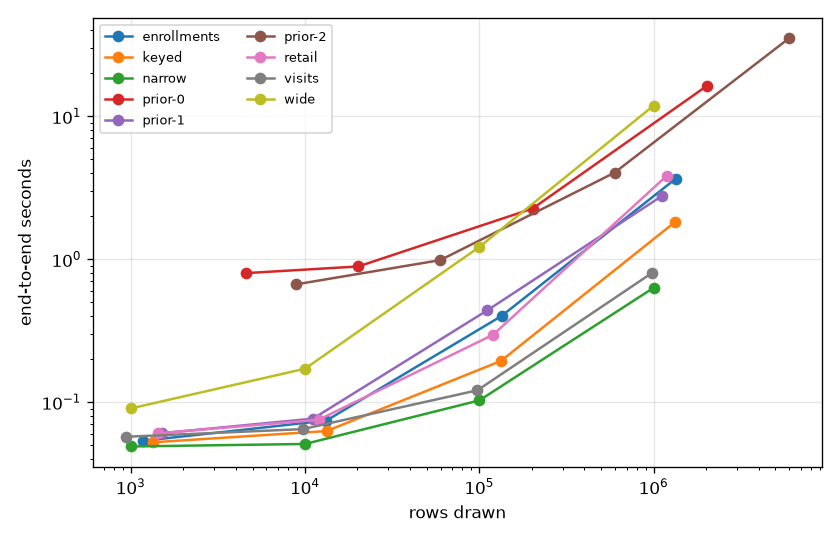
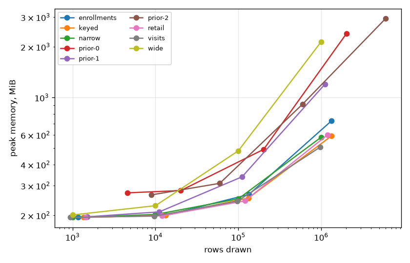

# Generation benchmark

Generated by `benchmarks/report.py` from [`results/2026-11-08-apple-m4.json`](results/2026-11-08-apple-m4.json); rerun with the command in [benchmarks/README.md](README.md). Times are seconds, the median over repeats with the range in brackets; each run is a fresh process, so peak memory includes the interpreter and imports (about 190 MiB).

## Environment

| | |
|---|---|
| commit | `e0c49b7` |
| when | 2026-11-08T22:51:47+00:00 |
| machine | Apple M4, 10 cores, 16.0 GiB, arm64 |
| platform | macOS-26.1-arm64-arm-64bit |
| Python | 3.12.0 |
| packages | plurel 2.0.0.dev0, numpy 2.5.1, pandas 3.0.5, pyarrow 25.0.0, scipy 1.17.0, relbench 3.0.1 |
| threads | library defaults |

## Phases

| Workload | Size | Rows (generated) | Cells (generated) | construct | realize | sample | database | write | read | Total | Generated cells/s sampled | Peak MiB | Disk MiB |
|---|---:|---:|---:|---:|---:|---:|---:|---:|---:|---:|---:|---:|---:|
| enrollments | 1,000 | 1,172 (842) | 5,200 (4,210) | 0.0042 | 0.0046 | 0.0025 | 0.0007 | 0.0044 | 0.0372 | 0.0536 | 1.68M | 195 (195–195) | 0.0 |
| enrollments | 10,000 | 13,267 (9,787) | 59,375 (48,935) | 0.0049 | 0.0124 | 0.0113 | 0.0018 | 0.0056 | 0.0385 | 0.0744 | 4.32M | 200 (199–200) | 0.1 |
| enrollments | 100,000 | 134,080 (99,100) | 600,440 (495,500) | 0.0156 | 0.165 (0.131–0.237) | 0.135 (0.129–0.199) | 0.0126 (0.0118–0.0227) | 0.0186 (0.0144–0.0258) | 0.0493 (0.0396–0.0522) | 0.401 (0.339–0.549) | 3.69M | 266 (260–270) | 0.8 |
| enrollments | 1,000,000 | 1,337,309 (988,379) | 5,988,685 (4,941,895) | 0.112 | 1.61 (1.61–1.63) | 1.58 (1.55–1.75) | 0.195 (0.19–0.209) | 0.0812 (0.0793–0.0927) | 0.0537 (0.0523–0.064) | 3.66 (3.6–3.84) | 3.13M | 729 (653–750) | 8.5 |
| keyed | 1,000 | 1,346 (1,306) | 4,678 (4,598) | 0.0032 | 0.0001 | 0.0042 | 0.0004 | 0.0047 | 0.0401 | 0.0524 (0.0477–0.0536) | 1.12M | 194 (194–195) | 0.0 |
| keyed | 10,000 | 13,291 (13,251) | 46,458 (46,378) | 0.0031 | 0.0001 | 0.0134 | 0.0005 | 0.0055 | 0.04 | 0.0628 | 3.47M | 200 (199–200) | 0.1 |
| keyed | 100,000 | 132,929 (132,889) | 465,010 (464,930) | 0.0029 | 0.0001 | 0.137 | 0.0006 | 0.0141 | 0.0399 | 0.194 (0.188–0.197) | 3.40M | 254 (252–256) | 1.6 |
| keyed | 1,000,000 | 1,329,187 (1,329,147) | 4,650,042 (4,649,962) | 0.0028 | 0.0001 | 1.7 (1.69–1.71) | 0.0037 | 0.0673 | 0.0545 | 1.83 (1.81–1.84) | 2.74M | 592 (579–600) | 15.2 |
| narrow | 1,000 | 1,000 (1,000) | 5,000 (5,000) | 0.001 | 0.005 | 0.001 | 0.0001 | 0.0033 | 0.0388 (0.036–0.048) | 0.049 (0.0459–0.0598) | 5.00M | 194 (194–195) | 0.0 |
| narrow | 10,000 | 10,000 (10,000) | 50,000 (50,000) | 0.0007 | 0.0047 | 0.0038 | 0.0001 | 0.0049 | 0.0367 | 0.051 | 13.16M | 202 (202–202) | 0.4 |
| narrow | 100,000 | 100,000 (100,000) | 500,000 (500,000) | 0.0008 | 0.0047 | 0.0401 | 0.0001 | 0.0184 | 0.0392 | 0.103 | 12.47M | 250 (250–252) | 3.8 |
| narrow | 1,000,000 | 1,000,000 (1,000,000) | 5,000,000 (5,000,000) | 0.0007 | 0.0045 | 0.503 | 0.0001 | 0.072 (0.0687–0.0738) | 0.0501 | 0.632 (0.625–0.633) | 9.95M | 582 (578–603) | 31.2 |
| prior-0 | 1,000 | 4,584 (4,584) | 51,144 (51,144) | 0.0293 | 0.538 (0.515–0.548) | 0.0999 (0.0977–0.11) | 0.0005 | 0.0426 (0.0317–0.0456) | 0.0903 (0.0793–0.0951) | 0.8 (0.781–0.803) | 0.51M | 272 (264–273) | 0.4 |
| prior-0 | 10,000 | 20,216 (20,216) | 242,094 (242,094) | 0.029 | 0.531 (0.508–0.556) | 0.198 (0.188–0.205) | 0.0005 | 0.0443 (0.0411–0.0527) | 0.0931 (0.0918–0.11) | 0.891 (0.887–0.928) | 1.23M | 281 (277–284) | 1.6 |
| prior-0 | 100,000 | 202,158 (202,158) | 2,420,932 (2,420,932) | 0.0291 | 0.555 (0.5–0.563) | 1.43 (1.37–1.44) | 0.0011 | 0.247 | 0.0623 | 2.27 (2.26–2.34) | 1.70M | 493 (492–512) | 15.9 |
| prior-0 | 1,000,000 | 2,021,604 (2,021,604) | 24,209,624 (24,209,624) | 0.0292 | 0.546 (0.54–0.563) | 15.2 (15.1–15.6) | 0.0083 | 0.452 (0.452–0.462) | 0.149 (0.132–0.169) | 16.4 (16.3–16.8) | 1.59M | 2,401 (2,359–2,426) | 143.1 |
| prior-1 | 1,000 | 1,512 (1,512) | 12,632 (12,632) | 0.0042 | 0.0002 | 0.0096 | 0.0002 | 0.0065 | 0.04 | 0.0607 | 1.32M | 196 (195–197) | 0.1 |
| prior-1 | 10,000 | 11,110 (11,110) | 82,162 (82,162) | 0.0043 | 0.0002 | 0.0222 | 0.0003 | 0.0086 | 0.0407 | 0.0767 | 3.70M | 210 (207–210) | 0.3 |
| prior-1 | 100,000 | 111,101 (111,101) | 821,630 (821,630) | 0.0045 | 0.0002 | 0.282 (0.247–0.337) | 0.0009 | 0.0541 (0.0534–0.108) | 0.0743 (0.0712–0.0976) | 0.439 (0.431–0.471) | 2.91M | 339 (337–344) | 3.5 |
| prior-1 | 1,000,000 | 1,111,009 (1,111,009) | 8,216,286 (8,216,286) | 0.0043 | 0.0002 | 2.55 (2.54–2.57) | 0.0086 | 0.136 | 0.067 | 2.77 (2.75–2.78) | 3.23M | 1,201 (1,200–1,232) | 30.7 |
| prior-2 | 1,000 | 8,878 (8,878) | 100,437 (100,437) | 0.0315 | 0.457 (0.45–0.524) | 0.0755 (0.075–0.0804) | 0.0012 | 0.03 | 0.0664 | 0.667 (0.655–0.728) | 1.33M | 264 (262–265) | 0.6 |
| prior-2 | 10,000 | 59,723 (59,723) | 654,752 (654,752) | 0.0313 | 0.452 (0.435–0.489) | 0.299 (0.291–0.334) | 0.0022 | 0.1 (0.0833–0.101) | 0.101 (0.0959–0.102) | 0.987 (0.961–1.04) | 2.19M | 310 (304–310) | 3.0 |
| prior-2 | 100,000 | 596,605 (596,605) | 6,541,409 (6,541,409) | 0.0312 | 0.45 (0.413–0.45) | 3.31 (3.29–3.43) | 0.0045 | 0.168 (0.168–0.173) | 0.0786 | 4.04 (3.98–4.17) | 1.98M | 914 (912–916) | 30.1 |
| prior-2 | 1,000,000 | 5,966,031 (5,966,031) | 65,413,893 (65,413,893) | 0.0312 | 0.453 (0.449–0.461) | 33.5 (33.2–37) | 0.0449 | 0.892 (0.883–0.906) | 0.21 (0.189–0.246) | 35.1 (34.8–38.7) | 1.95M | 2,938 (2,915–3,218) | 260.4 |
| retail | 1,000 | 1,425 (1,281) | 6,813 (6,405) | 0.0044 | 0.0058 | 0.0036 | 0.0008 | 0.0055 | 0.0404 | 0.0605 (0.056–0.0622) | 1.78M | 195 (195–196) | 0.0 |
| retail | 10,000 | 11,959 (10,895) | 57,643 (54,475) | 0.0045 | 0.0131 | 0.0101 | 0.0013 | 0.0068 | 0.0406 | 0.0753 (0.0707–0.0776) | 5.49M | 199 (197–199) | 0.1 |
| retail | 100,000 | 119,905 (109,361) | 578,413 (546,805) | 0.0074 | 0.115 (0.0953–0.123) | 0.112 (0.0932–0.113) | 0.0068 | 0.0138 | 0.0406 (0.0399–0.0451) | 0.296 (0.262–0.304) | 4.87M | 244 (232–251) | 0.9 |
| retail | 1,000,000 | 1,191,247 (1,085,943) | 5,745,603 (5,429,715) | 0.0401 | 1.71 (1.14–1.95) | 1.59 (1.14–2.05) | 0.0869 (0.0568–0.127) | 0.102 (0.0686–0.175) | 0.0768 (0.052–0.1) | 3.85 (2.49–4.2) | 3.41M | 601 (530–661) | 9.9 |
| visits | 1,000 | 943 (928) | 4,682 (4,640) | 0.0039 | 0.0006 | 0.0047 | 0.0012 | 0.0057 | 0.0412 | 0.0573 (0.0554–0.0628) | 0.97M | 194 (194–195) | 0.0 |
| visits | 10,000 | 9,706 (9,691) | 48,497 (48,455) | 0.0042 | 0.0006 | 0.009 | 0.0021 | 0.0069 | 0.042 (0.0398–0.0552) | 0.0648 (0.0613–0.0833) | 5.13M | 198 (198–198) | 0.2 |
| visits | 100,000 | 97,516 (97,501) | 487,547 (487,505) | 0.0037 | 0.0006 | 0.0494 (0.0473–0.0535) | 0.0108 | 0.0169 | 0.0397 (0.0387–0.048) | 0.121 (0.116–0.138) | 9.73M | 243 (240–248) | 2.4 |
| visits | 1,000,000 | 974,031 (974,016) | 4,870,122 (4,870,080) | 0.0036 | 0.0006 | 0.493 (0.473–0.503) | 0.124 | 0.11 (0.0801–0.179) | 0.0529 | 0.799 (0.754–0.831) | 9.72M | 508 (497–510) | 20.8 |
| wide | 1,000 | 1,000 (1,000) | 51,000 (51,000) | 0.0033 | 0.034 | 0.0075 | 0.0001 | 0.0063 | 0.0385 | 0.0904 | 6.80M | 201 (201–201) | 0.5 |
| wide | 10,000 | 10,000 (10,000) | 510,000 (510,000) | 0.0032 | 0.0339 | 0.0697 | 0.0001 | 0.0241 | 0.0405 | 0.172 (0.17–0.179) | 7.32M | 228 (227–229) | 4.7 |
| wide | 100,000 | 100,000 (100,000) | 5,100,000 (5,100,000) | 0.0036 | 0.0361 | 0.935 (0.878–1.13) | 0.0001 | 0.224 (0.16–0.242) | 0.0664 (0.0595–0.0743) | 1.22 (1.2–1.47) | 5.45M | 483 (475–494) | 47.9 |
| wide | 1,000,000 | 1,000,000 (1,000,000) | 51,000,000 (51,000,000) | 0.0032 | 0.0342 | 11.1 (10.9–11.4) | 0.0002 | 0.57 (0.554–0.69) | 0.195 (0.185–0.387) | 11.9 (11.6–12.5) | 4.60M | 2,146 (2,138–2,152) | 394.9 |

## Failures

None: all 108 runs finished.

## Scaling

