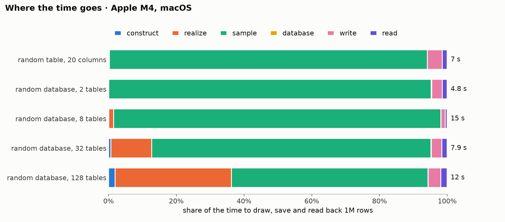

# Generation benchmark

Generated by `benchmarks/report.py` from [`results/2026-11-09-apple-m4.json`](results/2026-11-09-apple-m4.json); rerun with the command in [benchmarks/README.md](README.md), which describes the workloads. Times are seconds, the median of the runs with their range in brackets; each run is a fresh process with no warm-up, so peak memory includes the interpreter and imports (about 195 MiB).

## Environment

| | |
|---|---|
| commit | `1c546a1` |
| when | 2026-11-09T00:43:20+00:00 |
| machine | Apple M4, 10 cores, 16.0 GiB, arm64 |
| platform | macOS-26.1-arm64-arm-64bit |
| Python | 3.12.0 |
| packages | plurel 2.0.0.dev0, numpy 2.5.1, pandas 3.0.5, pyarrow 25.0.0, scipy 1.17.0, relbench 3.0.1 |
| threads | library defaults |

## Phases

| Workload | Tables | Rows | Cells | construct | realize | sample | database | write | read | Total | Rows/s sampled | Peak MiB | Disk MiB |
|---|---:|---:|---:|---:|---:|---:|---:|---:|---:|---:|---:|---:|---:|
| random table, 20 columns | 1 | 100,000 | 2,100,000 | 0.0023 | 0.0195 | 0.585 (0.585–0.598) | 0.0001 | 0.0809 (0.0761–0.103) | 0.0437 | 0.735 (0.725–0.766) | 0.17M | 478 (462–492) | 12.2 |
| random table, 20 columns | 1 | 250,000 | 5,250,000 | 0.0021 | 0.0188 | 1.48 (1.41–1.51) | 0.0001 | 0.139 (0.132–0.142) | 0.0511 | 1.69 (1.63–1.71) | 0.17M | 742 (734–747) | 28.0 |
| random table, 20 columns | 1 | 500,000 | 10,500,000 | 0.0022 | 0.0181 | 3.03 (2.99–3.06) | 0.0001 | 0.185 (0.18–0.187) | 0.0609 | 3.3 (3.25–3.32) | 0.16M | 1,166 (1,149–1,176) | 52.4 |
| random table, 20 columns | 1 | 1,000,000 | 21,000,000 | 0.0021 | 0.0183 | 6.54 (6.19–6.69) | 0.0002 | 0.307 (0.278–0.454) | 0.0994 (0.092–0.127) | 7.08 (6.62–7.14) | 0.15M | 1,512 (1,476–1,531) | 101.1 |
| random database, 2 tables | 2 | 100,000 | 1,088,456 | 0.0047 | 0.0002 | 0.445 (0.395–0.477) | 0.0009 | 0.083 (0.0661–0.0907) | 0.0474 (0.0461–0.0522) | 0.586 (0.538–0.598) | 0.22M | 414 (411–422) | 5.7 |
| random database, 2 tables | 2 | 250,000 | 2,721,138 | 0.0045 | 0.0002 | 1.07 (1.06–1.16) | 0.0019 | 0.0686 (0.067–0.0732) | 0.0485 | 1.2 (1.18–1.28) | 0.23M | 667 (664–687) | 13.1 |
| random database, 2 tables | 2 | 500,000 | 5,442,276 | 0.0044 | 0.0002 | 2.25 (2.11–2.26) | 0.0044 | 0.0988 (0.0925–0.115) | 0.0604 | 2.42 (2.3–2.43) | 0.22M | 998 (986–998) | 24.7 |
| random database, 2 tables | 2 | 1,000,000 | 10,884,552 | 0.0046 | 0.0002 | 4.58 (4.31–4.65) | 0.0082 | 0.149 | 0.0703 | 4.82 (4.54–4.87) | 0.22M | 1,318 (1,313–1,333) | 48.0 |
| random database, 8 tables | 8 | 100,000 | 1,356,606 | 0.0134 | 0.224 (0.213–0.235) | 1.51 (1.5–1.52) | 0.0029 | 0.133 (0.0831–0.164) | 0.0787 (0.0663–0.151) | 1.97 (1.95–2) | 0.07M | 639 (637–648) | 8.5 |
| random database, 8 tables | 8 | 250,000 | 3,391,518 | 0.0137 | 0.234 (0.227–0.234) | 3.64 (3.64–3.76) | 0.0022 | 0.245 (0.168–0.248) | 0.0569 | 4.2 (4.1–4.32) | 0.07M | 971 (968–974) | 20.0 |
| random database, 8 tables | 8 | 500,000 | 6,783,034 | 0.0137 | 0.232 (0.231–0.253) | 7.47 (7.34–8.2) | 0.0055 | 0.173 (0.135–0.2) | 0.0695 (0.0666–0.0875) | 7.99 (7.79–8.74) | 0.07M | 1,372 (1,210–1,376) | 37.5 |
| random database, 8 tables | 8 | 1,000,000 | 13,566,076 | 0.0139 | 0.219 (0.208–0.228) | 14.6 (14.6–15.3) | 0.0073 | 0.191 (0.186–0.201) | 0.0886 (0.0849–0.0928) | 15.1 (15.1–15.8) | 0.07M | 2,188 (2,056–2,217) | 72.9 |
| random database, 32 tables | 32 | 100,000 | 925,407 | 0.0494 | 0.851 (0.847–0.867) | 0.692 (0.657–0.693) | 0.0011 | 0.201 (0.163–0.224) | 0.0782 | 1.87 (1.82–1.9) | 0.14M | 414 (410–426) | 4.3 |
| random database, 32 tables | 32 | 250,000 | 2,313,553 | 0.0498 | 0.864 (0.848–0.942) | 1.64 (1.58–1.66) | 0.0039 | 0.183 (0.148–0.336) | 0.0825 (0.0811–0.0924) | 2.9 (2.73–2.99) | 0.15M | 579 (574–592) | 10.8 |
| random database, 32 tables | 32 | 500,000 | 4,627,092 | 0.0496 | 0.875 (0.873–0.892) | 3.02 (3–3.07) | 0.003 | 0.173 (0.153–0.186) | 0.0896 | 4.2 (4.17–4.29) | 0.17M | 832 (823–833) | 20.8 |
| random database, 32 tables | 32 | 1,000,000 | 9,254,176 | 0.0541 (0.0498–0.0553) | 0.957 (0.928–1.03) | 6.54 (6.09–8.39) | 0.0073 | 0.249 (0.241–0.267) | 0.123 (0.11–0.126) | 8.01 (7.43–9.79) | 0.15M | 1,290 (1,046–1,294) | 40.9 |
| random database, 128 tables | 128 | 100,000 | 1,020,378 | 0.225 | 4.07 (3.94–4.26) | 1.04 (0.972–1.08) | 0.0032 | 0.189 (0.17–0.195) | 0.191 | 5.77 (5.59–5.82) | 0.10M | 589 (581–598) | 6.1 |
| random database, 128 tables | 128 | 250,000 | 2,550,946 | 0.226 (0.225–0.233) | 3.98 (3.84–4.03) | 1.93 (1.9–1.98) | 0.0032 | 0.276 (0.263–0.281) | 0.193 | 6.63 (6.48–6.66) | 0.13M | 647 (639–650) | 14.4 |
| random database, 128 tables | 128 | 500,000 | 5,101,890 | 0.223 (0.221–0.295) | 4.13 (3.95–4.82) | 3.57 (3.49–4.45) | 0.0034 | 0.302 (0.301–0.309) | 0.202 (0.198–0.205) | 8.41 (8.25–10) | 0.14M | 733 (656–736) | 28.4 |
| random database, 128 tables | 128 | 1,000,000 | 10,203,772 | 0.226 (0.225–0.237) | 4.06 (3.81–4.56) | 6.85 (6.77–6.87) | 0.0039 | 0.446 (0.441–0.483) | 0.22 (0.211–0.226) | 11.9 (11.5–12.2) | 0.15M | 1,186 (1,182–1,190) | 56.3 |

## Failures

None: all 60 runs finished.

## Figures

