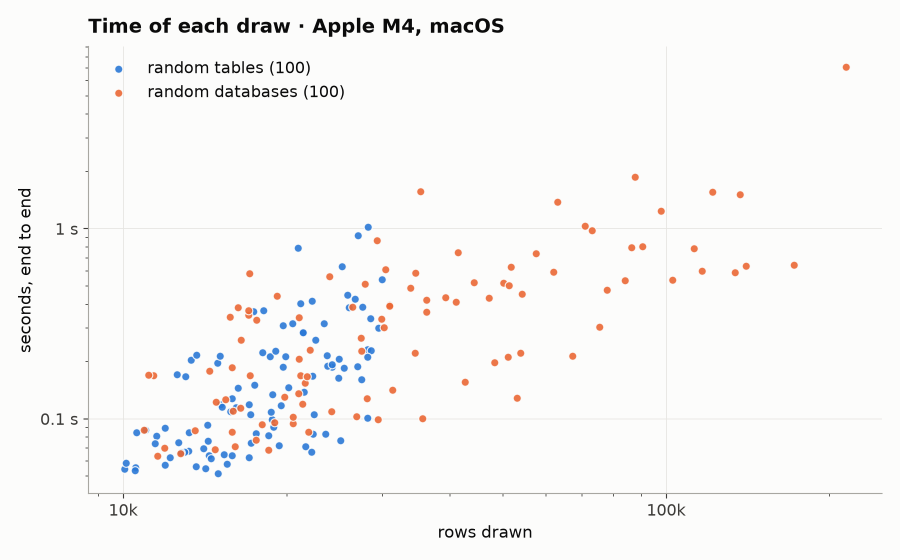
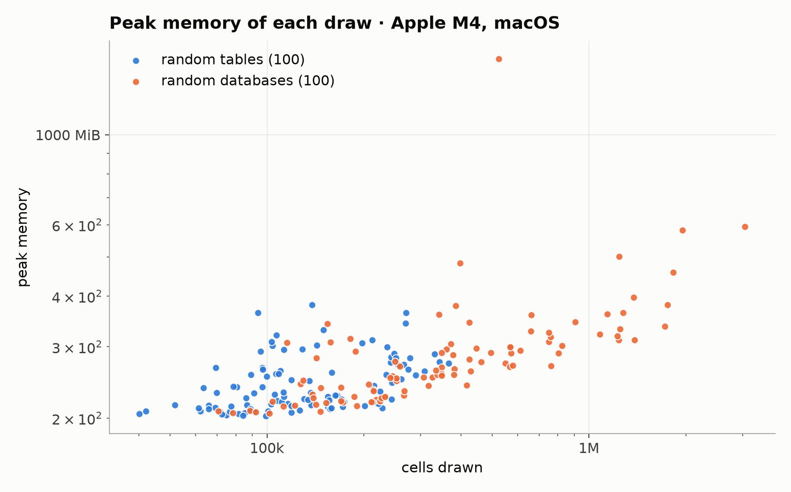

# Generation benchmark

Generated by `benchmarks/report.py` from [`results/2026-11-09-apple-m4.json`](results/2026-11-09-apple-m4.json); rerun with the command in [benchmarks/README.md](README.md). Each draw is one table or database from the default prior, at the row counts the prior draws, in a fresh process with no warm-up; peak memory includes the interpreter and imports, about 195 MiB.

## Environment

| | |
|---|---|
| commit | `8c87972` |
| when | 2026-11-09T02:20:26+00:00 |
| machine | Apple M4, 10 cores, 16.0 GiB, arm64 |
| platform | macOS-26.1-arm64-arm-64bit |
| Python | 3.12.0 |
| packages | plurel 2.0.0.dev0, numpy 2.5.1, pandas 3.0.5, pyarrow 25.0.0, scipy 1.17.0, relbench 3.0.1 |
| threads | library defaults |

## Random tables: 100 draws, 0 failed

| | median | 90th percentile | largest | smallest |
|---|---:|---:|---:|---:|
| tables | 1 | 1 | 1 | 1 |
| keys | 0 | 0 | 0 | 0 |
| rows | 18,681 | 27,087 | 29,923 | 10,044 |
| cells | 119,032 | 261,762 | 366,106 | 40,176 |
| seconds, end to end | 0.13 | 0.39 | 1.02 | 0.05 |
| seconds sampling | 0.05 | 0.29 | 0.93 | 0.01 |
| rows per second, end to end | 137,797 | 258,808 | 332,410 | 26,490 |
| peak memory, MiB | 231 | 302 | 381 | 202 |
| on disk, MiB | 0.6 | 1.4 | 1.9 | 0.1 |

Median share of the time: draw 1%, sample 43%, database 0%, write 10%, read 44%.

Slowest draws:

| seed | tables | keys | rows | seconds | peak MiB |
|---:|---:|---:|---:|---:|---:|
| 98 | 1 | 0 | 28,200 | 1.02 | 306 |
| 46 | 1 | 0 | 27,045 | 0.92 | 364 |
| 97 | 1 | 0 | 20,975 | 0.79 | 281 |
| 17 | 1 | 0 | 25,305 | 0.63 | 282 |
| 82 | 1 | 0 | 29,923 | 0.54 | 342 |

## Random databases: 100 draws, 0 failed

| | median | 90th percentile | largest | smallest |
|---|---:|---:|---:|---:|
| tables | 5 | 20 | 20 | 2 |
| keys | 6 | 49 | 105 | 1 |
| rows | 29,412 | 91,116 | 214,240 | 10,923 |
| cells | 339,544 | 1,238,599 | 3,049,067 | 70,629 |
| seconds, end to end | 0.32 | 0.81 | 7.09 | 0.06 |
| seconds sampling | 0.16 | 0.60 | 6.74 | 0.02 |
| rows per second, end to end | 110,756 | 244,904 | 411,505 | 22,518 |
| peak memory, MiB | 268 | 361 | 1,540 | 205 |
| on disk, MiB | 1.6 | 5.7 | 13.7 | 0.4 |

Median share of the time: draw 4%, sample 53%, database 0%, write 12%, read 26%.

Slowest draws:

| seed | tables | keys | rows | seconds | peak MiB |
|---:|---:|---:|---:|---:|---:|
| 97 | 20 | 88 | 214,240 | 7.09 | 594 |
| 58 | 16 | 72 | 87,566 | 1.87 | 458 |
| 13 | 11 | 18 | 35,261 | 1.57 | 1,540 |
| 94 | 18 | 48 | 121,597 | 1.56 | 582 |
| 2 | 20 | 105 | 136,814 | 1.51 | 381 |

## Failures

None: all 200 draws finished.

## Figures

